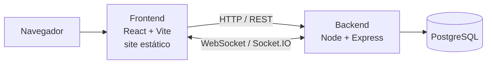
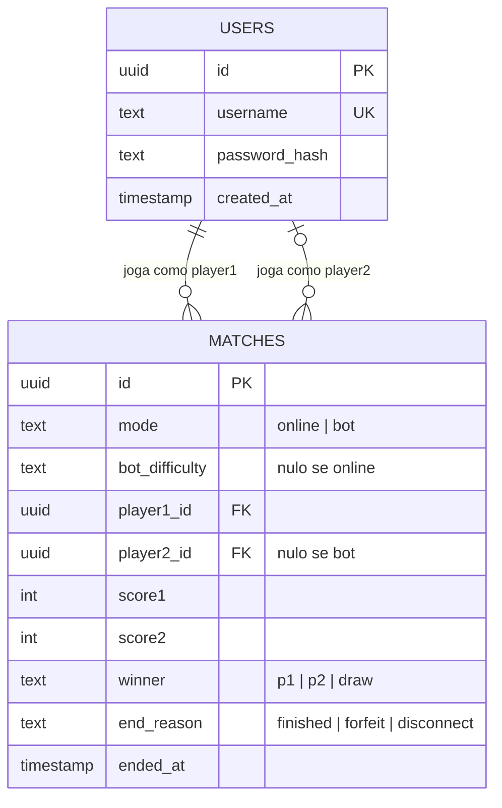
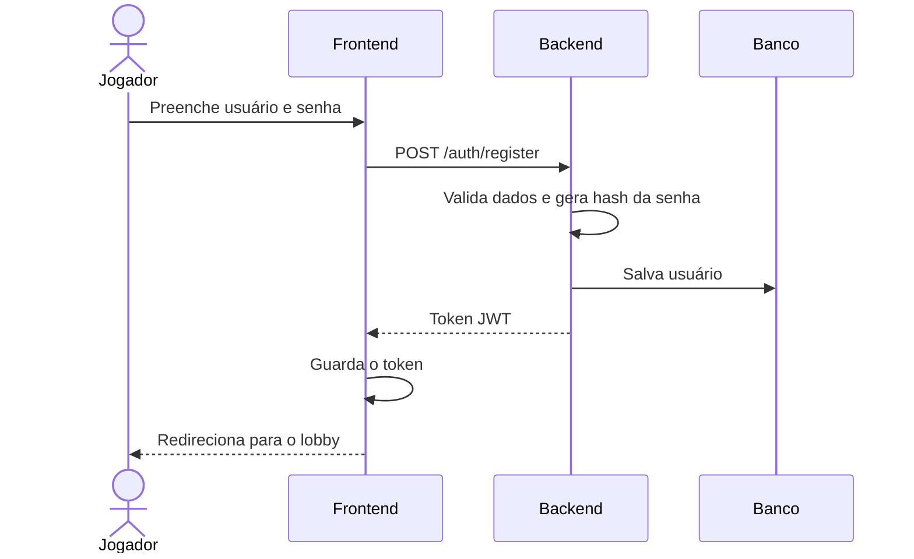
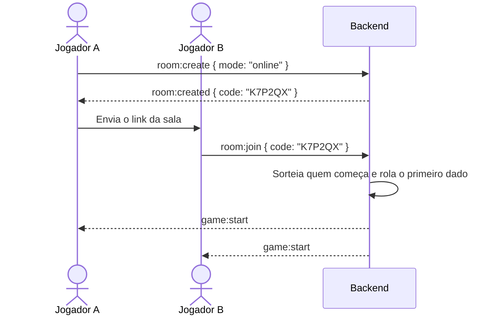
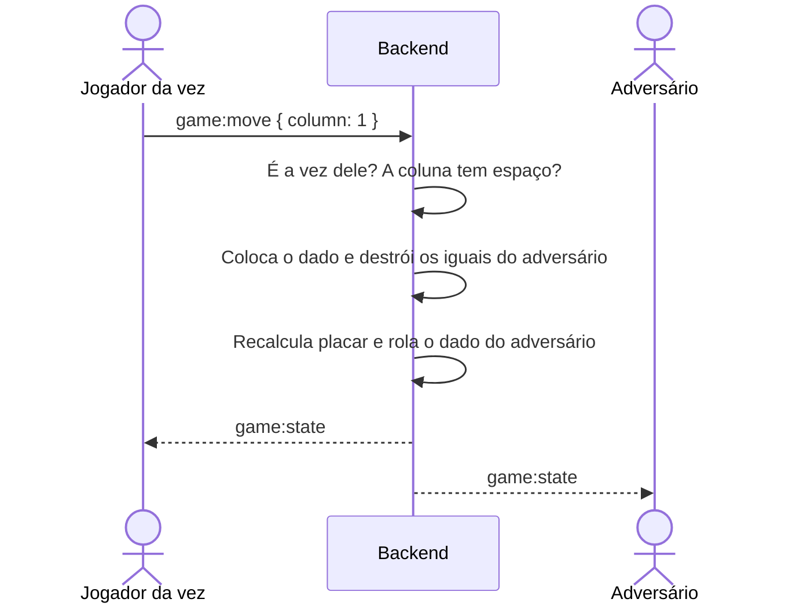
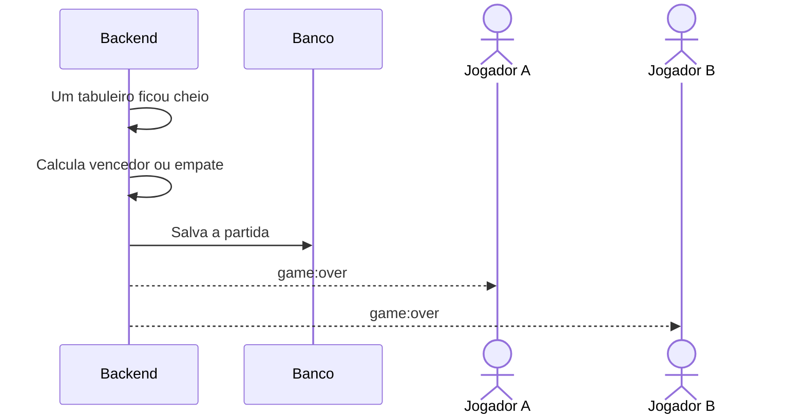

# Knucklebones Online

Sistema web do jogo de dados **Knucklebones**, inspirado no minigame de *Cult of the Lamb*. Os jogadores criam uma conta, jogam contra o computador ou contra outra pessoa online em tempo real, e acompanham o histórico das suas partidas.

---

## 1. Funcionalidades

- **Conta:** cadastro, login e logout.
- **Partida contra o bot:** três níveis de dificuldade (fácil, médio, difícil).
- **Multiplayer online:** criar uma sala, convidar um amigo por código ou link e jogar em tempo real.
- **Histórico:** lista das partidas jogadas e estatísticas (vitórias, derrotas, empates, maior pontuação).
- **Regras:** tela explicando como jogar.

---

## 2. Regras do jogo

- Cada jogador tem um tabuleiro com **3 colunas de 3 espaços**.
- Na sua vez, o jogador recebe um dado de 6 faces e o coloca em uma coluna que tenha espaço.
- **Destruição:** todos os dados de mesmo valor na coluna correspondente do adversário são removidos.
- **Pontuação da coluna:** soma de `valor × quantidade²` para cada valor distinto.
  - `[4, 4, 4]` → 4 × 9 = **36**
  - `[4, 4, 2]` → 4 × 4 + 2 × 1 = **18**
  - `[1, 2, 3]` → 1 + 2 + 3 = **6**
- **Pontuação total:** soma das 3 colunas.
- **Fim de jogo:** quando um dos tabuleiros fica cheio. Vence quem tiver mais pontos; pontuações iguais dão empate.

---

## 3. Arquitetura

O sistema é dividido em **frontend** e **backend separados**, cada um com seu próprio deploy. Os dois ficam no mesmo repositório, em pastas diferentes.



- **Frontend:** só cuida da interface. Mostra o tabuleiro, envia as ações do jogador e exibe o estado que recebe do backend. Não contém regras do jogo.
- **Backend:** contém toda a lógica. Autentica usuários, gerencia as salas, rola os dados, valida as jogadas, executa o bot e salva as partidas no banco.
- **O backend é a autoridade da partida:** o frontend só diz "quero jogar na coluna X". Isso impede trapaças e garante que o histórico salvo é confiável.
- **Comunicação:**
  - **REST** para ações pontuais: cadastro, login, histórico, perfil.
  - **Socket.IO** para a partida em si, que precisa de atualização em tempo real.
- **Autenticação entre domínios diferentes:** como frontend e backend ficam em endereços diferentes, o login devolve um **token JWT** que o frontend envia no cabeçalho `Authorization` das requisições e no *handshake* do Socket.IO. O backend libera o endereço do frontend via **CORS**.

---

## 4. Stack

| Parte | Tecnologia |
|---|---|
| Linguagem | TypeScript (front e back) |
| Frontend | React + Vite, React Router |
| Cliente de tempo real | `socket.io-client` |
| Backend | Node.js + Express |
| Tempo real | Socket.IO |
| Banco de dados | PostgreSQL |
| Acesso ao banco | Drizzle ORM |
| Autenticação | JWT + `bcryptjs` (hash de senha) |
| Validação de dados | Zod |
| Testes de unidade e integração | Vitest (+ `supertest` para a API) |
| Testes E2E | Playwright |
| Cobertura | `@vitest/coverage-v8` |
| CI | GitHub Actions (Linux, macOS e Windows) |
| Deploy do frontend | Vercel ou Netlify |
| Deploy do backend | Render |
| Banco em produção | Neon (Postgres gerenciado) |
| Banco nos testes | PGlite (Postgres em memória, roda em qualquer sistema sem Docker) |

---

## 5. Estrutura do repositório

```
knucklebones-online/
├── frontend/
│   └── src/
│       ├── pages/        # Login, Cadastro, Lobby, Partida, Histórico, Regras
│       ├── components/   # Tabuleiro, Coluna, Dado, Placar
│       ├── services/     # chamadas à API e conexão com o socket
│       └── hooks/        # useAuth, usePartida
├── backend/
│   └── src/
│       ├── game/         # regras do jogo e bot (código puro, sem I/O)
│       ├── auth/         # cadastro, login, middleware de token
│       ├── matches/      # histórico e estatísticas
│       ├── rooms/        # gerenciamento de salas e eventos do socket
│       ├── db/           # schema e conexão com o banco
│       ├── app.ts        # configura o Express
│       └── server.ts     # inicia o servidor HTTP e o Socket.IO
├── e2e/                  # testes Playwright
└── .github/workflows/    # CI
```

---

## 6. API REST

| Método | Rota | Descrição | Precisa de login |
|---|---|---|---|
| POST | `/auth/register` | Cria uma conta | Não |
| POST | `/auth/login` | Faz login e devolve o token | Não |
| GET | `/auth/me` | Dados do usuário logado | Sim |
| GET | `/users/:username/matches` | Histórico de partidas | Sim |
| GET | `/users/:username/stats` | Estatísticas do jogador | Sim |
| GET | `/health` | Verifica se o backend está no ar | Não |

> O logout é feito no frontend, apagando o token salvo.

---

## 7. Eventos do Socket.IO

| Direção | Evento | Dados | Descrição |
|---|---|---|---|
| Cliente → Servidor | `room:create` | `{ mode, difficulty? }` | Cria uma sala online ou contra o bot |
| Servidor → Cliente | `room:created` | `{ code }` | Devolve o código da sala |
| Cliente → Servidor | `room:join` | `{ code }` | Entra numa sala |
| Servidor → Cliente | `room:error` | `{ reason }` | Sala inexistente, cheia etc. |
| Servidor → Cliente | `game:start` | `{ state, you, opponent }` | A partida começou |
| Cliente → Servidor | `game:move` | `{ column }` | Jogada na coluna escolhida |
| Servidor → Cliente | `game:state` | `{ state }` | Novo estado após uma jogada |
| Servidor → Cliente | `game:over` | `{ winner, scores }` | Fim da partida |
| Cliente → Servidor | `game:forfeit` | — | Desistir |
| Servidor → Cliente | `opponent:disconnected` | — | O adversário caiu |

---

## 8. Modelo de dados



---

## 9. Fluxos

### 9.1 Cadastro e login



O login segue o mesmo caminho com `POST /auth/login`: o backend compara a senha com o hash salvo e devolve o token.

### 9.2 Criar e entrar numa sala online



### 9.3 Uma jogada



Se a jogada for inválida, o backend a ignora e responde só para quem jogou com um erro.

### 9.4 Fim da partida



### 9.5 Partida contra o bot

Igual à partida online, mas a segunda vaga da sala é ocupada pelo bot, que roda no backend. Depois de cada jogada do usuário, o backend calcula a jogada do bot, espera um pequeno intervalo para ela ser visível e envia o novo estado.

- **Fácil:** escolhe uma coluna válida aleatória.
- **Médio:** escolhe a coluna que dá mais pontos para ele e tira mais pontos do adversário.
- **Difícil:** analisa algumas jogadas à frente, considerando os possíveis valores do dado (expectiminimax).

### 9.6 Desconexão

1. A conexão de um jogador cai no meio da partida.
2. O backend avisa o adversário (`opponent:disconnected`) e espera 60 segundos.
3. Se o jogador voltar nesse tempo, recebe o estado atual e a partida continua.
4. Se não voltar, o adversário vence por abandono e a partida é salva.

---

## 10. User stories

**Prioridade:** **Alta** = essencial para o sistema funcionar · **Média** = importante · **Baixa** = se der tempo.

### Conta

**US01 — Cadastro** · Alta
Como visitante, quero criar uma conta com usuário e senha, para ter meu histórico salvo.
- Usuário único, com 3 a 20 caracteres; senha com pelo menos 8.
- Após o cadastro, já entro logado.

**US02 — Login** · Alta
Como jogador, quero entrar na minha conta, para acessar o jogo e o meu histórico.
- Dados errados mostram "usuário ou senha inválidos".

**US03 — Logout** · Alta
Como jogador, quero sair da minha conta, para proteger meu acesso em computadores compartilhados.
- Depois de sair, páginas que exigem login me levam para a tela de login.

### Partida

**US04 — Jogar um dado** · Alta
Como jogador, quero ver o dado rolado e escolher uma coluna para ele, para montar minha estratégia.
- Só posso jogar na minha vez e em colunas com espaço.

**US05 — Destruir dados do adversário** · Alta
Como jogador, quero que meu dado remova os dados de mesmo valor na coluna correspondente do adversário, para atrapalhar a pontuação dele.
- Remove todos os dados iguais daquela coluna e só dela.

**US06 — Ver o placar** · Alta
Como jogador, quero ver a pontuação de cada coluna e o total dos dois jogadores, para decidir onde jogar.
- O placar atualiza após cada jogada.

**US07 — Fim da partida** · Alta
Como jogador, quero ver quem venceu e o placar final, para saber o resultado.
- A partida termina quando um tabuleiro enche; empate é possível.

**US08 — Desistir** · Média
Como jogador, quero desistir de uma partida, para encerrá-la sem esperar o fim.
- O adversário vence e a partida vai para o histórico.

### Contra o bot

**US09 — Jogar contra o bot** · Alta
Como jogador, quero jogar contra o computador, para jogar sozinho.
- O resultado é salvo no histórico.

**US10 — Escolher a dificuldade** · Média
Como jogador, quero escolher entre fácil, médio e difícil, para ter um desafio adequado.

### Multiplayer online

**US11 — Criar sala** · Alta
Como jogador, quero criar uma sala e receber um código e um link, para convidar um amigo.

**US12 — Entrar em sala** · Alta
Como jogador, quero entrar numa sala pelo código ou pelo link, para jogar com quem me convidou.
- Código inválido mostra "sala não encontrada"; sala cheia mostra "sala cheia".

**US13 — Jogar em tempo real** · Alta
Como jogador, quero ver as jogadas do adversário assim que ele joga, para acompanhar a partida.

**US14 — Saber de quem é a vez** · Média
Como jogador, quero ver claramente de quem é a vez, para não ficar esperando sem saber.

**US15 — Voltar após cair a conexão** · Média
Como jogador, quero voltar para a partida se minha conexão cair, para não perder um jogo em andamento.
- Tenho 60 segundos para voltar; depois disso, perco por abandono.

**US16 — Revanche** · Baixa
Como jogador, quero propor uma revanche ao fim da partida, para jogar de novo com o mesmo adversário.

### Histórico

**US17 — Ver meu histórico** · Alta
Como jogador, quero ver a lista das minhas partidas, para acompanhar meu desempenho.
- Cada item mostra data, adversário (ou bot e dificuldade), placar e resultado, da mais recente para a mais antiga.

**US18 — Ver minhas estatísticas** · Média
Como jogador, quero ver vitórias, derrotas, empates e maior pontuação, para medir minha evolução.

**US19 — Ranking** · Baixa
Como jogador, quero ver um ranking dos jogadores com mais vitórias online, para competir.

### Ajuda

**US20 — Regras** · Média
Como iniciante, quero ler as regras com exemplos de pontuação, para aprender a jogar.

---

## 11. Testes

- **Unidade (Vitest):** regras do jogo (pontuação, posicionamento, destruição, fim de jogo), bot, validação de dados, geração e verificação de token, gerenciamento de salas.
- **Integração (Vitest + supertest):** rotas da API com banco em memória (PGlite) e fluxo de sala com dois clientes Socket.IO.
- **E2E (Playwright):** cadastro e login, partida contra o bot até o fim, histórico, destruição de dados, partida online com dois navegadores, sala inexistente.
- **Dados previsíveis nos testes:** em modo de teste, o backend aceita uma semente fixa para o dado, para os testes não dependerem de sorte.
- **CI:** GitHub Actions roda tudo, com cobertura mínima de 80%, em Linux, macOS e Windows a cada commit.

---

## 12. Deploy

| Parte | Onde | Configuração |
|---|---|---|
| Frontend | Vercel ou Netlify | Variáveis `VITE_API_URL` e `VITE_SOCKET_URL` apontando para o backend; regra de redirecionamento para as rotas do React |
| Backend | Render | Variáveis `DATABASE_URL`, `JWT_SECRET` e `FRONTEND_URL` (usada no CORS) |
| Banco | Neon | Fornece a `DATABASE_URL` |

> No plano gratuito do Render, o backend hiberna após um tempo sem uso e demora cerca de um minuto para voltar. Abrir o site alguns minutos antes de uma demonstração.

---

## 13. Observações

- Usar apenas a **mecânica** do jogo. Não usar arte, ícones, sons ou logo de *Cult of the Lamb*.