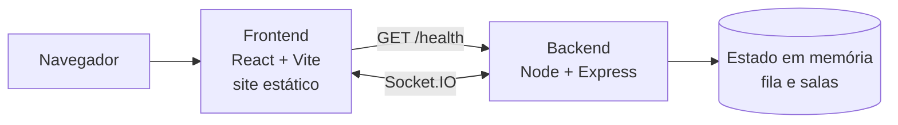
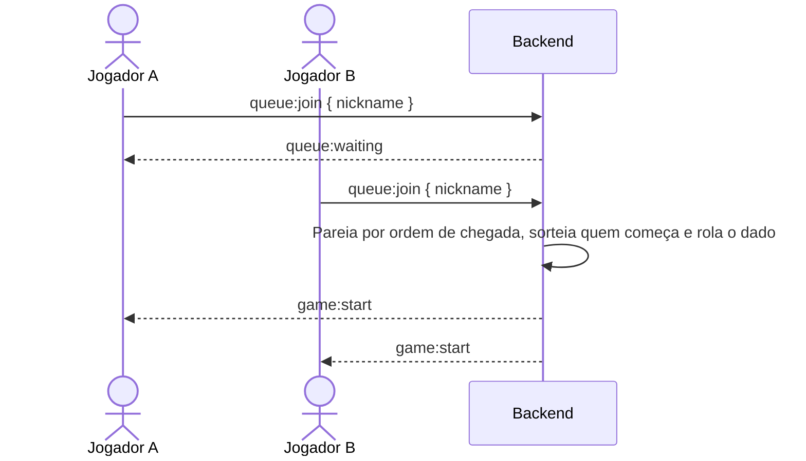
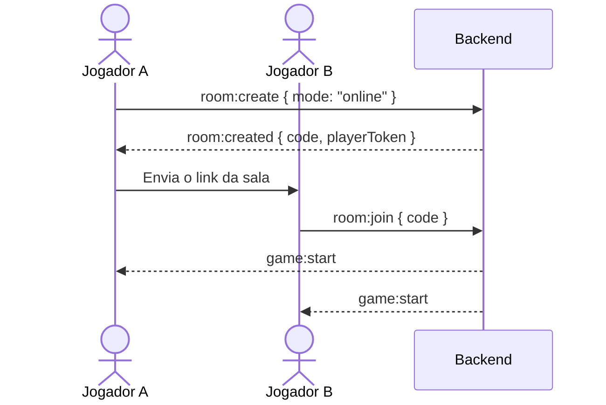
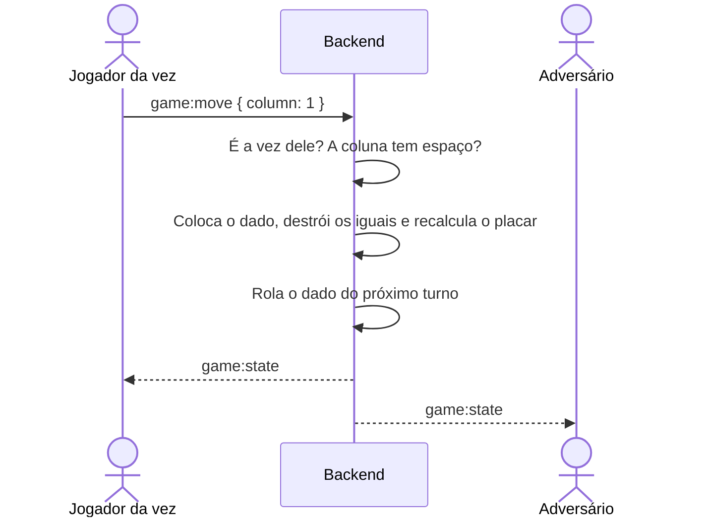

# Knucklebones Online

Sistema web do jogo de dados **Knucklebones**, inspirado no minigame de *Cult of the Lamb*. Os jogadores abrem o site e jogam, sem cadastro, contra outra pessoa ou contra o computador.

---

## 1. Funcionalidades

- **Fila online:** pareamento automático com outro jogador.
- **Partida contra o bot:** três níveis de dificuldade (fácil, médio, difícil).
- **Sala privada:** criar uma sala e convidar um amigo por código ou link.
- **Apelido opcional:** guardado apenas no navegador.
- **Regras:** tela explicando como jogar.

**Fora do escopo:** autenticação, contas, histórico, estatísticas, ranking e banco de dados.

---

## 2. Regras do jogo

- Cada jogador tem um tabuleiro com **3 colunas de 3 espaços**.
- Na sua vez, o jogador recebe um dado de 6 faces e o coloca em uma coluna que tenha espaço.
- **Destruição:** todos os dados de mesmo valor na coluna correspondente do adversário são removidos.
- **Pontuação da coluna:** soma de `valor × quantidade²` para cada valor distinto.
  - `[4, 4, 4]`: 4 × 9 = **36**
  - `[4, 4, 2]`: 4 × 4 + 2 × 1 = **18**
  - `[1, 2, 3]`: 1 + 2 + 3 = **6**
- **Pontuação total:** soma das 3 colunas.
- **Fim de jogo:** quando um dos tabuleiros fica cheio. Vence quem tiver mais pontos; pontuações iguais dão empate.

---

## 3. Arquitetura

Frontend e backend são separados, cada um com seu próprio deploy, no mesmo repositório.



- **Frontend:** só cuida da interface. Envia as intenções do jogador e exibe o estado recebido. Não contém regras do jogo.
- **Backend:** é a autoridade da partida. Gerencia fila e salas, rola os dados, valida as jogadas e executa o bot.
- **Sem persistência:** fila, salas e partidas ficam na memória do processo. Reiniciar o backend encerra as partidas em andamento, e o backend roda em uma única instância.
- **CORS:** o backend libera apenas o endereço configurado em `FRONTEND_URL`.

### Identidade do jogador

- O **apelido** tem de 1 a 20 caracteres (letras, números, espaço, hífen e sublinhado) e fica no `localStorage`. Vazio, o servidor gera `Visitante-NNNN`. Apelidos podem se repetir.
- Ao ocupar um assento numa partida, o jogador recebe um **`playerToken`** aleatório, guardado no `sessionStorage`. Ele serve apenas para retomar aquela partida após uma queda ou recarga da página.

---

## 4. Stack

| Parte | Tecnologia |
|---|---|
| Linguagem | TypeScript (front e back) |
| Frontend | React + Vite, React Router |
| Tempo real | Socket.IO e `socket.io-client` |
| Backend | Node.js + Express |
| Validação de dados | Zod |
| Testes de unidade e integração | Vitest (+ `supertest` e Testing Library) |
| Testes E2E | Playwright |
| Cobertura | `@vitest/coverage-v8` |
| CI | GitHub Actions (Linux, macOS e Windows) |
| Deploy | Vercel (frontend) e Render (backend) |

---

## 5. Estrutura do repositório

```
knucklebones-online/
├── frontend/
│   └── src/
│       ├── pages/        # Lobby, Partida, Regras, página não encontrada
│       ├── components/   # Tabuleiro, Coluna, Dado, Placar
│       ├── services/     # /health e conexão com o socket
│       └── hooks/        # useApelido, usePartida
├── backend/
│   └── src/
│       ├── game/         # regras do jogo e bot (código puro, sem I/O)
│       ├── rooms/        # salas, fila e eventos do socket
│       ├── config/       # variáveis de ambiente
│       ├── app.ts        # configura o Express
│       └── server.ts     # inicia o servidor HTTP e o Socket.IO
├── e2e/                  # testes Playwright
└── .github/              # CI e modelos
```

---

## 6. API e rotas

| Método | Rota do backend | Descrição |
|---|---|---|
| GET | `/health` | Verifica se o backend está no ar |

| Rota do frontend | Tela |
|---|---|
| `/` | Lobby: apelido, fila online, bot e sala privada |
| `/partida/:codigo` | Sala de espera e partida (também é o link de convite) |
| `/regras` | Regras |
| qualquer outra | Página não encontrada |

---

## 7. Eventos do Socket.IO

Os eventos, dados e erros estão em [contrato-socket.md](contrato-socket.md). Mudanças no contrato exigem revisão das duas pessoas da equipe.

---

## 8. Fluxos

### 8.1 Fila online



Quem está na fila pode cancelar (`queue:leave`). Quem desconecta é removido. A tela de espera sugere jogar contra o bot.

### 8.2 Sala privada



Uma sala sem segundo jogador expira em 10 minutos.

### 8.3 Uma jogada



Uma jogada inválida não altera o estado, e só quem a enviou recebe `game:error`.

### 8.4 Fim da partida

Quando um tabuleiro enche, o backend calcula o resultado e envia `game:over`. Nada é salvo; a sala é removida após 5 minutos. A revanche só começa quando os dois pedem.

### 8.5 Partida contra o bot

`room:create { mode: "bot", difficulty }` inicia a partida imediatamente. Depois de cada jogada do usuário, o backend envia o novo estado, espera um pequeno intervalo (`BOT_DELAY_MS`, 800 ms por padrão) e envia a jogada do bot.

- **Fácil:** coluna válida aleatória.
- **Médio:** coluna que mais soma pontos para ele e mais tira do adversário.
- **Difícil:** algumas jogadas à frente, considerando os valores possíveis do dado (expectiminimax).

### 8.6 Desconexão

1. A conexão de um jogador cai durante a partida.
2. O backend avisa o adversário (`opponent:disconnected`), pausa a partida e espera 60 segundos.
3. Se o jogador voltar (`game:rejoin`), os dois continuam de onde pararam.
4. Se não voltar, quem ficou vence por abandono.
5. Se os dois saírem, ou se a partida for contra o bot e o prazo acabar, ela é descartada.

---

## 9. Histórias de usuário

O planejamento tem 30 histórias em [backlog.md](backlog.md), acompanhadas pelas [issues do GitHub](https://github.com/claclarinete/Knucklebones/issues).

---

## 10. Testes

| Meta | Mínimo |
|---|---|
| Testes de unidade | 30 |
| Testes E2E (Playwright) | 5 |
| Cobertura (linhas, funções, ramos e instruções) | 80% em cada projeto |

- **Unidade:** regras do jogo, bot, fila, salas, validação, componentes e hooks.
- **Integração:** `/health` e fluxo de partida com dois clientes Socket.IO.
- **E2E:** partida contra o bot até o fim, fila com dois navegadores, sala por link, sala inexistente, desistência e desconexão.
- **Dados previsíveis:** fora de produção o backend aceita `DICE_SEED`, que fixa o dado, quem começa e os sorteios do bot.
- **CI:** a cada commit, em Linux, macOS e Windows. Será configurado depois da implementação, conforme [ci-cd.md](ci-cd.md).

As boas práticas estão em [CONTRIBUTING.md](../CONTRIBUTING.md#testes).

---

## 11. Deploy

Será configurado depois da implementação, conforme [ci-cd.md](ci-cd.md).

| Parte | Onde | Configuração |
|---|---|---|
| Frontend | Vercel | `VITE_API_URL` e `VITE_SOCKET_URL` apontando para o backend |
| Backend | Render | `FRONTEND_URL` apontando para o frontend |

> No plano gratuito da Render, o backend hiberna sem uso e demora cerca de um minuto para voltar. Abra o site alguns minutos antes de uma demonstração.

---

## 12. Observações

- Usar apenas a **mecânica** do jogo. Não usar arte, ícones, sons ou logo de *Cult of the Lamb*.
